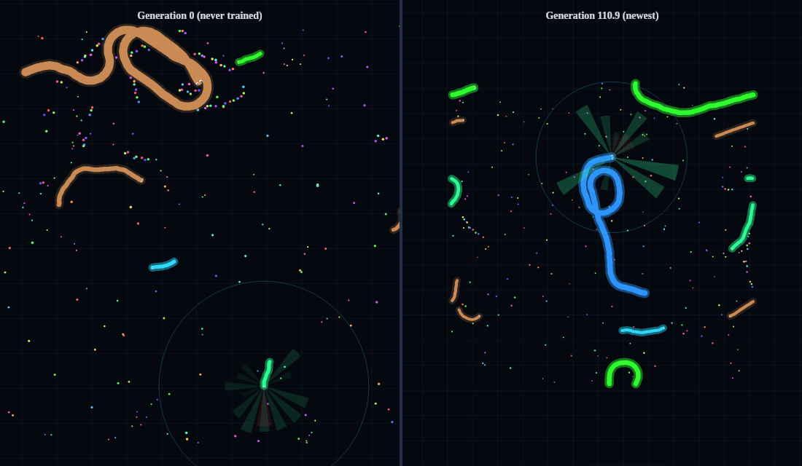

# Terrelbytes SnekBrain

**AI Reinforcement Learning Demonstration Program**

Watch an AI teach itself to play a snake arena game, live, on your own PC.

It starts out knowing nothing. Nobody tells it what food is or that crashing is bad. It plays thousands of games in the background, keeps whatever scored better, and the snake on your screen gets the newer brain every few seconds. Leave it running and come back to a snake that hunts.



## Download

Get **SnekBrain-x.y.z-setup.exe** from the [latest release](https://github.com/Robzombie954/SnekBrain/releases/latest) and run it. Windows 10 or 11, 64-bit. It installs just for you, with no admin prompt.

> **"Windows protected your PC"?** The installer isn't code-signed, so Windows SmartScreen shows an "unknown publisher" warning. Click **More info**, then **Run anyway**. If you want to be sure the file is the real one, compare it with `SHA256SUMS.txt` on the release page (`Get-FileHash .\SnekBrain-1.0.0-setup.exe` in PowerShell).

## What you can do

- **Watch it learn.** The game is always on screen, even in Turbo. A chart, a "what's happening" panel and a log of level ups and records show how far it has come.
- **Before / after.** The same game played by the brand-new brain and the newest one, side by side.
- **Look inside.** See what the snake senses (food, danger, other snakes, walls) and how sure it is about each move.
- **Play against it.** Steer your own snake with the mouse or arrow keys.
- **Tournament.** Pit saved brains against each other.
- **Highlights.** Records, close calls and big takedowns are saved by themselves, so you can replay the best moments.
- **Hall of Fame.** Every record-setting generation is kept, so you can watch it or branch a new brain from it.
- **Save, branch and share brains.** Start new ones with different reward settings (Balanced, Hunter, Survivor, Glutton or your own), branch from any saved generation, and send a brain to a friend as one `.snekbrain` file.
- **Clips and timelapses.** Record a clip, or a timelapse of the brain improving generation by generation.
- **Screensaver and stream layout.** A full-screen game view, and a 16:9 layout with big stats for streaming. In OBS, add a browser source for `http://127.0.0.1:47317/#stream` (the usual address) while SnekBrain is running.
- **Normal, Overnight and Turbo.** Normal learns quietly with low priority and a CPU cap. Turbo uses more of your PC to learn faster. It pauses on its own while you watch a video and picks up again afterwards.

It learns harder levels as it improves (more snakes, less food, sharper opponents), and when it stops improving it explores more on its own to get unstuck.

## How it works

Each snake is driven by a small neural network: 68 sensor readings in, two layers of 256, six possible moves out (about 85,000 numbers). It's trained with PPO, a reinforcement learning method, using [Stable-Baselines3](https://github.com/DLR-RM/stable-baselines3) and [PyTorch](https://pytorch.org) on your processor. It plays against a league of its own past selves, so it keeps meeting tougher opponents.

The app is a small Python engine that trains in a separate background process, plus a window (Microsoft Edge's app mode) that draws the game and runs the newest brain right in the page. Brains are saved to `%LOCALAPPDATA%\SnekBrain`. Training is crash-safe and stops before your disk gets full.

## Optional extras (all off until you turn them on)

- **GPU boost** (Settings): downloads NVIDIA's CUDA build of PyTorch (about 2.5 GB) for cards that support it. The processor stays the default, and for a network this small the game simulation is often the bottleneck, so try it and compare.
- **AI assistant hook** (Settings): lets an AI assistant on your own PC (anything that speaks MCP, like Claude Desktop) read stats and start or pause training. Localhost only, with its own key, and it can't delete or export anything.
- **Start with Windows** (Settings).

## Privacy

No account, no telemetry, no ads. SnekBrain only goes online for two things: checking GitHub for a new version once a day (you can turn that off; it always asks before installing, and checks the download's SHA-256 first), and the GPU download, only when you click it.

## Run from source

Python 3.13 on Windows (Linux works for training and the window, without the video pause):

```
pip install torch numpy gymnasium cloudpickle psutil
pip install --no-deps stable-baselines3
python run.py
```

Tests: `python tests/test_trainer_run.py` (a real short training run). The installer is built by `packaging/build_installer.py` with [pynsist](https://pynsist.readthedocs.io) and NSIS; GitHub Actions builds, installs, smoke-tests and releases it (`.github/workflows/build.yml`).

## License

MIT, see [LICENSE](LICENSE). Third-party parts are listed in [THIRD_PARTY_NOTICES.md](THIRD_PARTY_NOTICES.md). SnekBrain is an original game and isn't affiliated with any other snake game.

Made by Terrelbytes AI Solutions. Questions or ideas: robert@terrelbytes.com, or open an issue.
